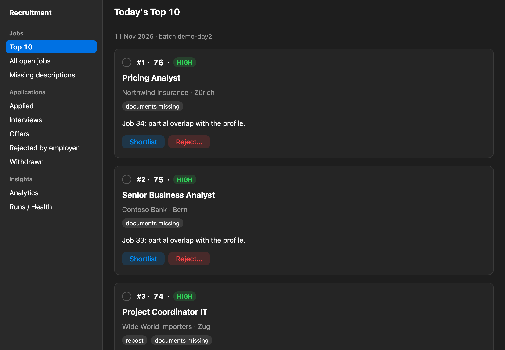
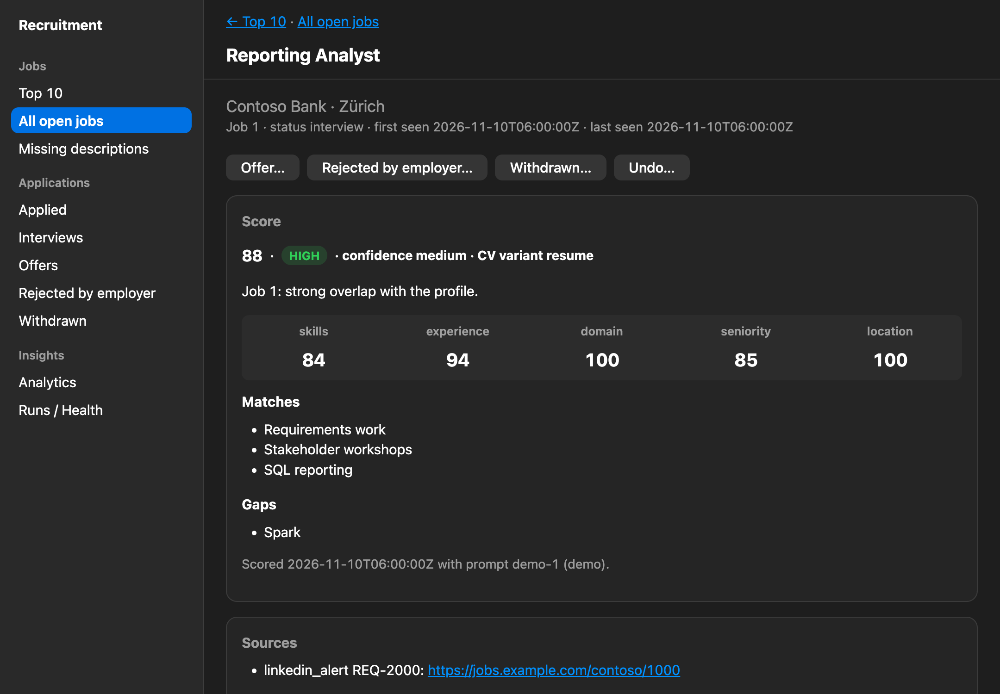
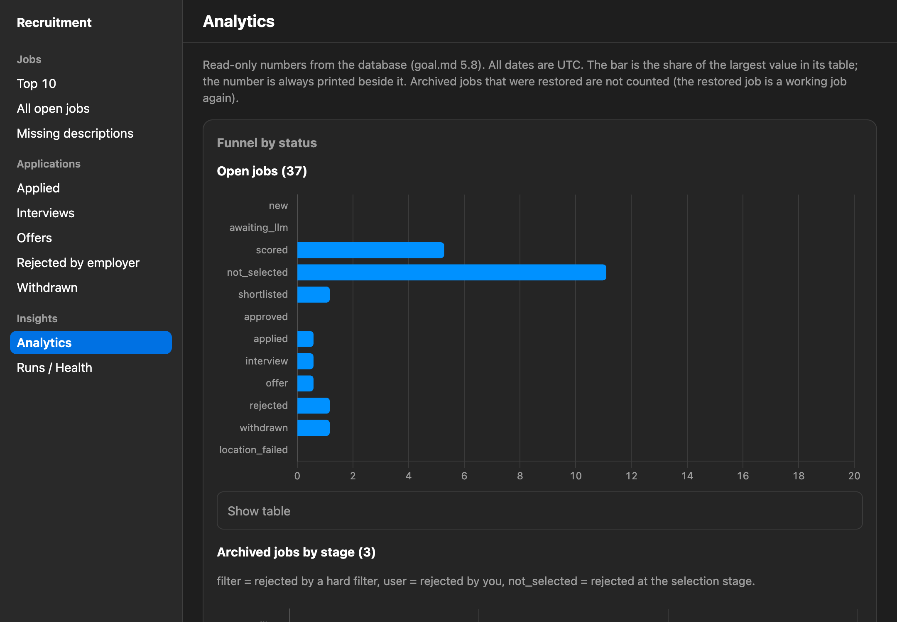
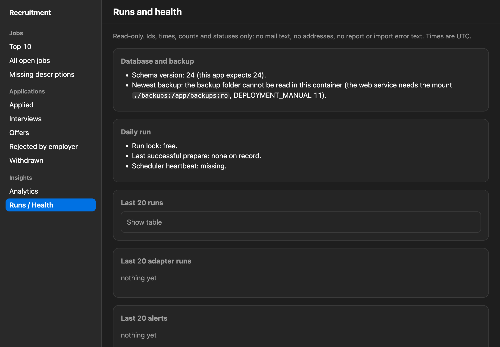
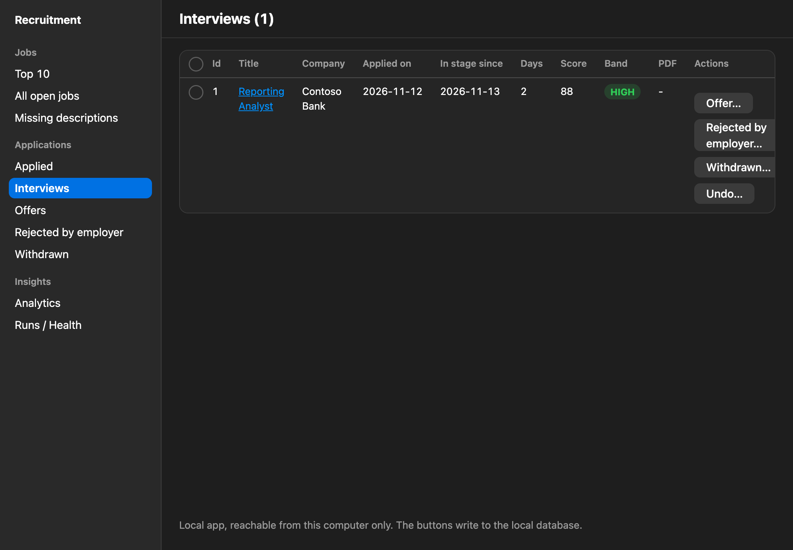
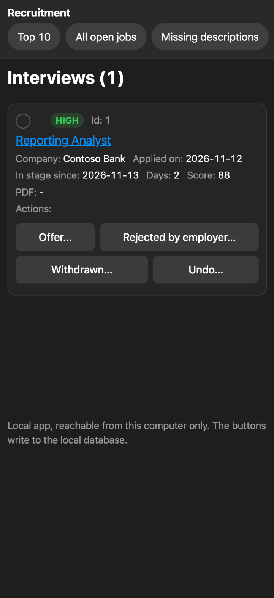
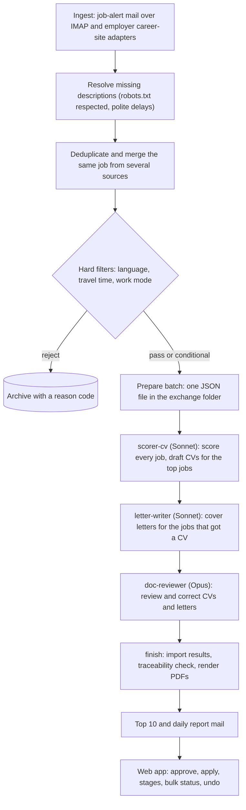
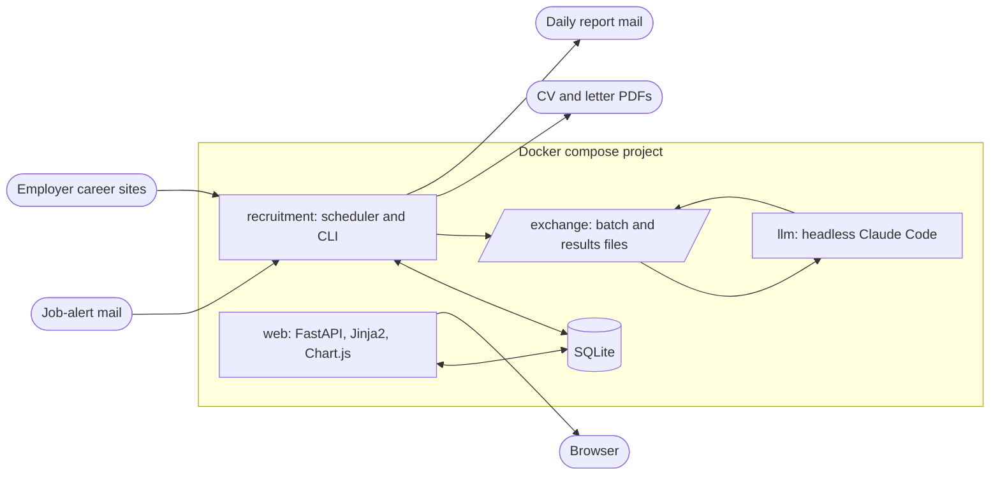
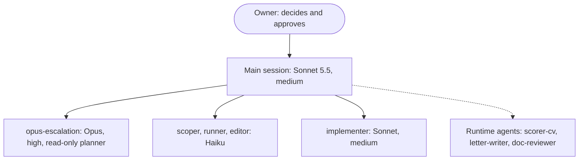

<!--
Version: 0.99.0
Date: 2026-11-15
Status: verified: tests measured at v0.99.0 on 15 Nov 2026 (3,807 passed and 21 skipped, full suite on macOS, 3,828 in all); CLI commands, web routes and modules as measured at v0.99.0 (41 CLI commands, 33 web routes without the login routes (36 route decorators in app/web.py minus the 3 login routes), 75 Python files under app/; commits, merged pull requests and releases measured with git and gh on 15 Nov 2026 at v0.97.0); the pipeline, services and agents were read in the code, compose.yaml and .claude/agents/ on 14 Nov 2026. Screenshots: demo database of fictional jobs, 15 Nov 2026.
-->

<div align="center">

# Job Match Pipeline

**A self-hosted, agent-built job-search engine.**
Every morning it reads the alerts, drops what doesn't fit, scores the rest, and writes a fact-checked CV and cover letter for the best matches.


</div>

---

## 🎯 Why this exists

- **Triage, not browsing.** Job alerts arrive from several sources in volume. The pipeline turns them into a ten-item morning list: duplicates merged, jobs that fail hard rules (language, commute, work mode) archived with a reason code, the rest scored 0 to 100 against a written rubric.
- **No invented facts.** Every tailored CV and cover letter is checked against one structured fact file before it can be approved. An employer, title, date, number or skill that is not in the fact file blocks the document (`app/traceability.py`).
- **Runs at home, costs no API fees.** It runs in Docker on a home NAS. The language-model work is done by headless Claude Code under a subscription login, not by a pay-per-token API key.

## 📊 At a glance

| | |
|---|---|
| Built in | **16 days** (30 Oct to 14 Nov 2026) |
| Commits / pull requests / releases | **373** / **196** / **190** |
| Automated tests | **3,828** |
| CLI commands (`python -m app ...`) | **41** |
| Web routes | **33** |
| Python modules in `app/` | **75** |
| Job-site integrations | **8** employer career-site adapters, **4** alert-mail parsers, **8** description readers (JobCloud, Jibe, Refline, one employer-specific site, schema.org JSON-LD pages, and the public Greenhouse, Lever and Ashby boards) |
| AI agents | **8** (5 for development, 3 at runtime) |

<sub>Tests measured at v0.99.0 on 15 Nov 2026 (3,807 passed, 21 skipped). CLI commands, web routes and modules measured at v0.99.0 on 15 Nov 2026 (`pytest --collect-only`, `python -m app --help`, the route table of the app without the login routes, `find app -name '*.py'`). Commits, pull requests and releases are as measured at v0.93.0.</sub>

## 🖼️ Screenshots

<table>
  <tr>
    <td align="center" width="50%"><br><sub>Today's Top 10: ranked, scored, one click to act</sub></td>
    <td align="center" width="50%"><br><sub>Job detail: sub-scores, matches, gaps, filter trail</sub></td>
  </tr>
  <tr>
    <td align="center" width="50%"><br><sub>Analytics: funnel and archive charts (Chart.js)</sub></td>
    <td align="center" width="50%"><br><sub>Runs and health: every pipeline run, watchdog</sub></td>
  </tr>
  <tr>
    <td align="center" width="50%"><br><sub>Applications: one list per stage, with the buttons that fit it</sub></td>
    <td align="center" width="50%"><br><sub>Interviews on a phone (about 390 px): the stage list fits the width</sub></td>
  </tr>
</table>

<sub>Screenshots from a demo database of fictional jobs (`scripts/seed_demo_db.py`).</sub>

## ⚙️ How it works



Letters are not written for every scored job. The batch carries a `tailoring` block (`app/batch.py`): documents are for fresh jobs ranked within `documents_top_n` (default 10) whose overall score is at least `min_score` (default 60) and that have a description. The scorer scores the whole batch; in `app/headless.py` the letters and review stages run only when the documents file holds a CV.

| Stage | What happens | Code |
|---|---|---|
| Ingest | Alert mails are parsed by 4 parsers; 8 employer career-site adapters list jobs directly | `app/mailbox.py`, `app/parsers/`, `app/adapters/` |
| Resolve | A job without a description is looked up on the employer's own site; permitted or public sources only | `app/resolver/` |
| Dedup and merge | The same job from several sources becomes one job with several sources | `app/dedup.py`, `app/merge.py` |
| Hard filters | Rules only, no LLM; every rejection is archived with a reason code and can be restored | `app/filters/`, `app/location.py`, `app/travel.py` |
| Prepare | Writes `batch_<run>.json` with the jobs, the prompt, the schemas and the profile hashes | `app/batch.py`, `app/pipeline.py` |
| Score and draft | Sonnet scores against the rubric and drafts CVs | `app/headless.py`, `.claude/agents/scorer-cv.md` |
| Letters and review | Sonnet writes letters; Opus reviews and corrects every CV and letter | `.claude/agents/letter-writer.md`, `.claude/agents/doc-reviewer.md` |
| Finish | Validates the results file, runs the traceability check, renders PDFs, sends the report | `app/results.py`, `app/traceability.py`, `app/pdf.py`, `app/report.py` |
| Decide | Approve, shortlist, apply, reject and undo in a small web app; after applying: interview, offer, accepted, rejected by employer and withdrawn, for one job or a selection (with a confirmation; swipe and multi-select on touch screens) | `app/web.py`, `app/approval.py`, `app/statusflow.py`, `app/static/select.js` |
| Interviews and notes | Interview rounds (date and time, shown in Europe/Zurich) and notes on each job page; kept on archive, restore and merge; `python -m app interviews --job ID` lists the rounds | `app/interviews.py`, `app/db.py`, `app/merge.py`, `app/cli.py` |

## 🏗️ Architecture



Three services from one image: `recruitment` (scheduler and CLI, no ports), `web` (profile `web`) and `llm` (profile `llm`, its own network, no database and no mail credentials). Details in [docs/ARCHITECTURE.md](docs/ARCHITECTURE.md).

## 🤖 Built by an AI agent team



| Agent | Model | Effort | Tools | Job |
|---|---|---|---|---|
| `scoper` | Haiku | medium | read-only plus Bash | Collects facts and checks documents against explicit rules |
| `runner` | Haiku | low | Read, Bash | Runs tests and commands, reports results |
| `editor` | Haiku | medium | edit and Bash | Applies fully specified edits |
| `implementer` | Sonnet | medium | edit and Bash | Writes code and tests from a decided plan |
| `opus-escalation` | Opus | high | read-only by rule | Plans non-trivial work, diagnoses repeated failures |
| `scorer-cv` | Sonnet | medium | edit and Bash | Runtime: scores jobs, drafts tailored CVs |
| `letter-writer` | Sonnet | medium | all except Agent | Runtime: writes cover letters |
| `doc-reviewer` | Opus | low | Read, Edit, search | Runtime: reviews and corrects every CV and letter |

How it was done, and the rules that kept the agents honest: [docs/AI_WORKFLOW.md](docs/AI_WORKFLOW.md).

## 🧭 Engineering principles

- **Spec first, one source of truth.** A single specification document drives the code; a decision is recorded in it in the same change.
- **Verified, assumed, unknown.** Every status block separates what was checked from what was guessed. "Should work" is not evidence.
- **A failing test before the fix.** Bug fixes come with a test that fails first and then passes.
- **Polite fetching.** robots.txt is read and respected, requests are slow and capped per host, and a run stops at the first 403, 429 or server error. LinkedIn was planned as a last-resort source and then dropped, because its robots.txt disallows everything.
- **Privacy by design.** Address, secrets and database files never enter the repository; a CI guard fails if they do.
- **SemVer for code and docs.** Every change that ships bumps the version and has a changelog entry.
- **Hard-to-revert changes ship alone.** Migrations and scoring changes on live data get their own release.

## 🧰 Tech stack

| Layer | Choice |
|---|---|
| Language | Python 3.14 |
| Web | FastAPI 0.162.0, Uvicorn, Jinja2 (server-rendered), Chart.js |
| Storage | SQLite in WAL mode with numbered migrations |
| PDF | fpdf2 with an embedded open-licence font |
| Validation | JSON Schema (jsonschema), YAML configuration |
| Packaging | Docker image, compose project with profiles |
| LLM | Claude Code CLI, headless, under a subscription login |
| Tests | pytest, pytest-xdist, a fake `claude` executable |

## 🚀 Quick start

```bash
cp config.example.yaml config.yaml        # then edit: mail folders, places, profile
cp compose.env.example compose.env
docker compose --env-file compose.env up -d --build
docker compose --env-file compose.env exec recruitment python -m app status
```

The scheduler is off by default (`schedule.enabled: false`), so you can run each command by hand first.

<details>
<summary>Run the tests locally</summary>

```bash
python -m venv .venv
.venv/Scripts/python -m pip install -r requirements-dev.txt     # Windows; use .venv/bin/python elsewhere
.venv/Scripts/python -m pytest -q
```

Tests use temporary databases and no network. Network checks are separate files that skip unless `RECRUITMENT_NETWORK_TESTS=1`.

</details>

## 🗂️ Repository tour

<details>
<summary>Open the tree</summary>

```text
app/                  application code (75 modules)
  adapters/           employer career-site adapters
  parsers/            job-alert mail parsers
  resolver/           description resolver: sources, robots.txt, matching
  filters/            language and Poland rules, filter runner
  templates/ static/  web pages, styles, Chart.js
  headless.py         worker for the llm service
  pipeline.py         prepare and finish, run lock, signals
  traceability.py     fact check of generated documents
.claude/agents/       the eight agent definitions
prompts/              scoring prompt, versioned
profile/              fact file and CV variants
tests/                pytest suite, fixtures, fake claude
docs/                 architecture, AI workflow, decisions
compose.yaml          recruitment, web and llm services
config.example.yaml   every setting, documented
```

</details>

## 🧠 Key decisions

A few of the choices that shaped the system; the full ADR-style list is in [docs/DECISIONS.md](docs/DECISIONS.md).

- **File-based batch exchange instead of an API.** Scoring runs in a subscription session, so the app and the model talk through JSON files, validated on both sides.
- **A reviewer model gates every document.** A cheaper model writes, a stronger one reviews, and a deterministic fact check has the last word.
- **Rules before LLM.** Language, commute and work mode are plain code with reason codes; the model only sees what survives.
- **Respect over reach.** A job source that forbids automated access is not used.

## 🪞 About this copy

This is a sanitised public copy. The persona and the profile are fictional, personal values were removed, and the commit history of the private working repository is not included. The numbers above were measured in the private repository.

## 👤 Author

**Jakub Pszczelowski** · [GitHub](https://github.com/Pszczelowski)

Licensed under the MIT License.

