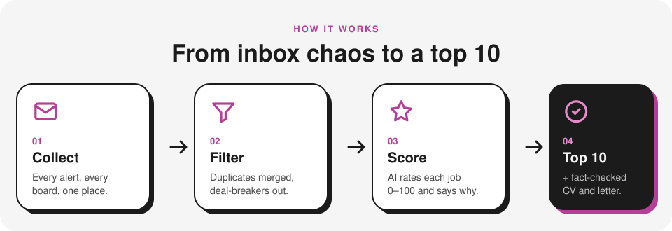
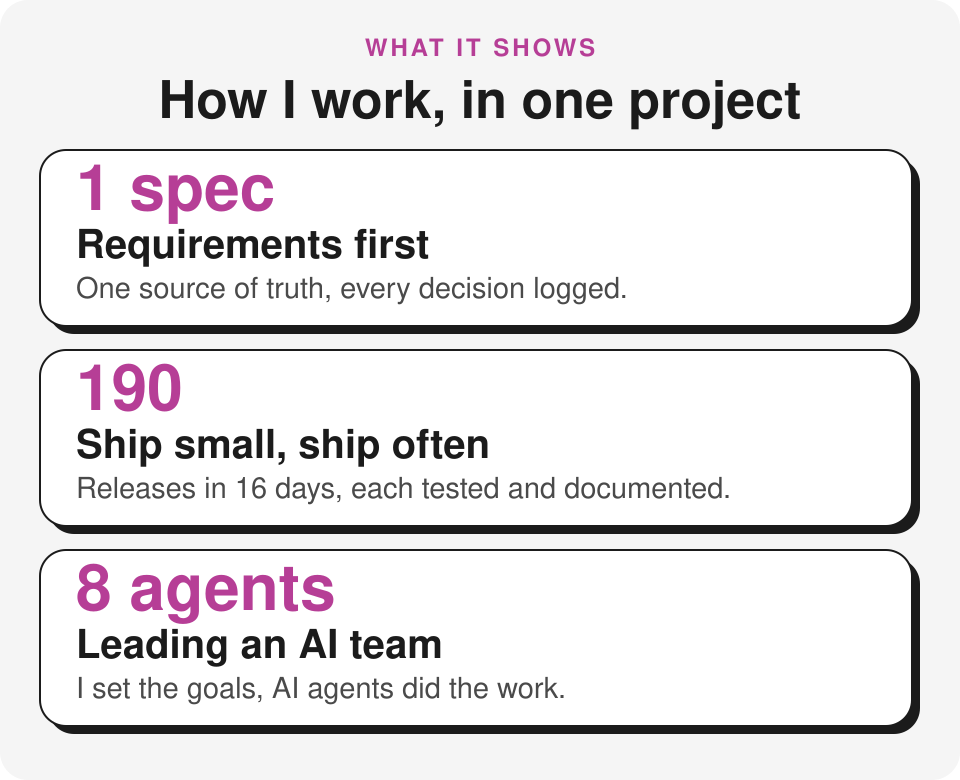
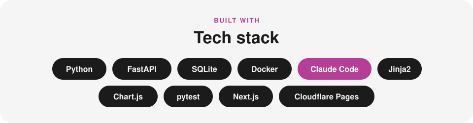
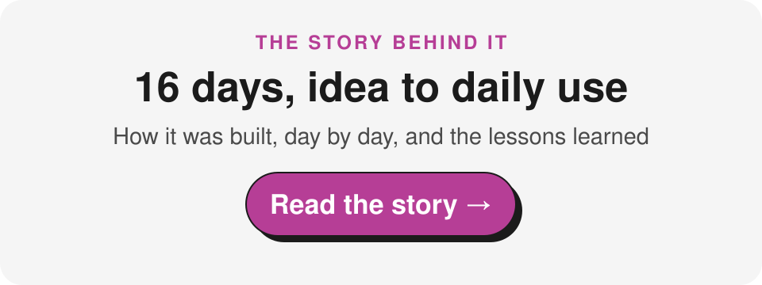
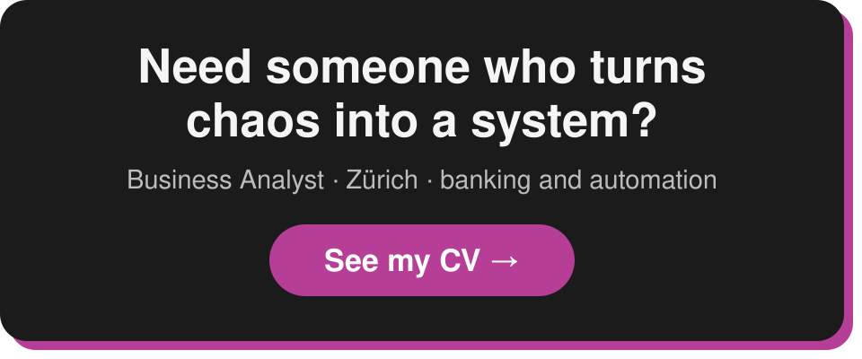

<!--
Version: 0.105.2
Date: 2026-11-16
Status: verified: tests measured at v0.99.0 on 15 Nov 2026 (3,807 passed, 21 skipped); releases measured with gh on 15 Nov 2026; the agent count was read in .claude/agents/ on 14 Nov 2026. Graphics: docs/assets/readme/*.svg (v0.104.0). Screenshot: demo database of fictional jobs, 15 Nov 2026.
-->

# I got tired of job alerts, so I built a robot to read them 🙂

Hi, I'm Jakub, a Business Analyst in Zürich. For ten years I've helped banks like UBS, Credit Suisse and Clearstream turn messy manual processes into clean, tested, automated ones.

When my own job hunt grew to almost 1,000 alerts a month, I did what I do at work: wrote down the requirements, built the tool, and tested it properly.

- **Every morning** it reads the alerts and gives me a top-10 list.
- **It explains its choices**: why a job fits, and what's missing.
- **It keeps me honest**: a fact-checker blocks anything that isn't on my real CV.

> [!IMPORTANT]
> **I read and send every application myself.** The app can't send anything. It sorts and suggests; every decision and every click on "send" is mine.

| ~1,000 | 16 days | 3,800+ |
|:---:|:---:|:---:|
| alerts a month, sorted | from idea to daily use | automated tests |

**[See my CV →](https://pszczelowski.pages.dev/)**

---

  

