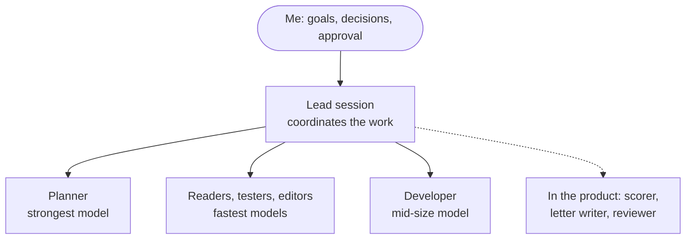

<!--
Version: 0.105.0
Date: 2026-11-17
Status: verified: agents from the frontmatter of .claude/agents/*.md; rules and their dates from goal.md 5.10 and CHANGELOG.md (read 14 to 17 Nov 2026). Unknown: the time saved against writing the code by hand.
-->

# Working with AI agents

I ran this project like a small delivery team. I was the product owner: I set the goals, made the decisions and approved every change. AI agents did the reading, coding and testing.

## The team

| Role | Model size | Does |
|---|---|---|
| Planner | Large | Plans bigger changes and finds the cause of stubborn bugs. Reads, never edits. |
| Developer | Medium | Writes code and tests from an agreed plan. |
| Readers, testers, editors | Small | Collect facts, run the tests, apply exact edits. |
| Scorer and letter writer | Medium | In the product: score jobs, draft CVs and letters. |
| Reviewer | Large | In the product: checks and corrects every CV and letter. |

**Why this split:** the right model for each job. Small models are fast and cheap for reading and running; the large one is saved for decisions where quality matters most.

## How work flowed

1. **Spec first.** One written specification is the single source of truth. Every decision goes in with its date and version.
2. **Plan, then build.** Non-trivial work starts with a short brief: outcome, scope, acceptance criteria.
3. **Small releases.** One branch per change, a pull request, a version number and a changelog entry: 190+ releases in 16 days.
4. **Tests are the gate.** The full suite runs before every merge.

## House rules for the agents

These came from watching the agents work, and they made the output far more reliable:

- **Show, don't claim.** No "done" or "fixed" without the test output next to it.
- **Cite the source.** A statement about the code points to the file and line.
- **Fail first.** A bug fix comes with a test that failed before the fix.
- **Two strikes, then escalate.** After two failed attempts, the planner takes over.
- **Say what is not checked.** Every report ends with a "Not checked:" line.
- **Ask, don't guess.** An unclear requirement is a question, not an assumption.

## Lessons learned

- **Agents need clear rules, like any team.** The best results came after the house rules were written down. A rule that lives only in a document is easy to skip; a rule enforced by a test isn't.
- **Guardrails belong in code.** Early on a database copy slipped into version control. The fix was not another reminder but an automatic check that fails the build. It never happened again.
- **Plan for limits.** Free build minutes ran out and AI usage limits cut runs short. Both became design inputs: tests moved to a local gate, and AI work is saved in small chunks so nothing is lost.
- **Right-size the model.** Moving routine work to smaller models cut cost sharply without hurting quality, because the expensive model was kept for planning and review.
- **Keep the human in the loop.** The app drafts and suggests; it can't send anything. That one decision made every other risk manageable.

Next: [Key decisions →](DECISIONS.md)
