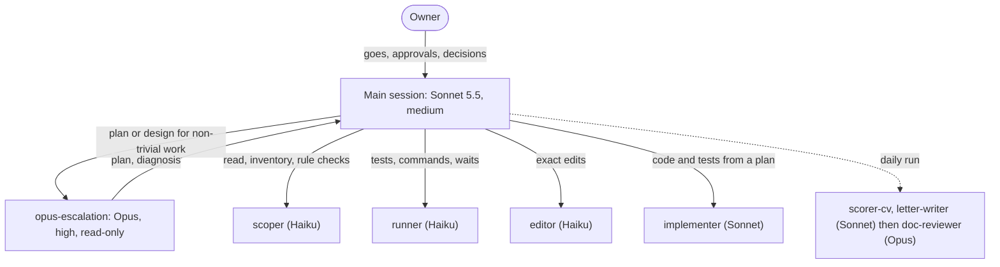

# How it was built with agents

Version: 0.94.0
Date: 2026-11-14
Status: verified: agent models, effort and tools from the frontmatter of `.claude/agents/*.md`; rules and routing from `goal.md` 5.10 and `CLAUDE.md`; version numbers from `CHANGELOG.md` and the git tags (185 tags, 362 commits at v0.93.0); read 14 Nov 2026. Unknown: how much time or money the approach saved against writing the code by hand; usage per day was never measured to a stable figure.

The project was built between 30 Oct and 14 Nov 2026 by one owner working with Claude Code. The owner decided; a main session coordinated; cheaper and more specialised agents did the reading, running, editing and implementing. This page describes the working method, including what went wrong.

## Spec first

`goal.md` is the single source of truth: requirements, decisions with their date and version, what is verified, assumed or unknown. `CLAUDE.md` is a short pointer to it. Every decision or changed requirement is recorded there in the same change, with a version bump and a changelog entry. The first committed version of the specification was 0.3.0; the code followed it. A new session does not start from memory: it starts from a digest of the specification, the changelog and the latest phase report.

## The agents

Eight agents live in `.claude/agents/`.

| Agent | Model | Effort | Rights | Why |
|---|---|---|---|---|
| `scoper` | Haiku | medium | Read, Grep, Glob, Bash (read-only by rule) | Reading is cheap and the output is facts with a source; nothing to decide |
| `runner` | Haiku | low | Read, Bash | Runs tests and commands; reports counts and failures; does not fix |
| `editor` | Haiku | medium | Read, Edit, Write, Grep, Glob, Bash | Applies edits the main session has written out; no decisions, no git, no database |
| `implementer` | Sonnet | medium | Read, Write, Edit, Grep, Glob, Bash | Writes code and tests from a decided plan; stops after two failed fix attempts |
| `opus-escalation` | Opus | high | Read, Grep, Glob, Bash (read-only by rule) | Plans non-trivial work, designs, diagnoses; does not edit |
| `scorer-cv` | Sonnet | medium | Read, Write, Edit, Grep, Glob, Bash | Runtime: scores a batch and drafts the CVs |
| `letter-writer` | Sonnet | medium | all tools except Agent | Runtime: writes the cover letters only |
| `doc-reviewer` | Opus | low | Read, Edit, Grep, Glob | Runtime: reviews and corrects every CV and letter; edits only those objects |

## Routing

Rules of the routing (`goal.md` 5.10, decided 2 Nov 2026, refined 2 and 3 Nov):

- The main session runs Sonnet at medium effort every day. Opus is used only through `opus-escalation`, and the owner may switch to Opus for planning only when brainstorming.
- `opus-escalation` is called on five triggers (the same test still failing after two fix attempts; an unclear CI failure; a design choice with real trade-offs; a change to database-writing, backup, release, secrets or mail code; a large diff before the pull request) and, since 3 Nov (v0.66.1), as planner and designer for every non-trivial task.
- Commit, push, pull request and merge stay with the main session. There is no reviewer agent for code; the only reviewer agent is `doc-reviewer`, for documents.

## Rules against overconfidence

A Sonnet session at medium effort is fast and sometimes too sure of itself. After the owner pointed that out (2 Nov 2026), these rules were written into `goal.md` 5.10 and bind the main session and every worker:

1. No "done", "fixed" or "works" without the command and its output in the same turn.
2. A statement about the code cites a file and line read in this session, never memory.
3. A bug fix comes with a test that fails first and then passes, or the report says why that was not possible.
4. Tests are not changed to make them pass unless the requirement changed; every changed test is named with the reason.
5. After two failed attempts stop and escalate; no third guess.
6. Every report and pull request ends with "Not checked:".
7. Worker reports are not taken on trust: the diff stat and the test count are checked.
8. An unclear requirement is a question to the owner, not a guess.
9. "Should work" is not evidence: write verified, assumed or unknown.
10. Ask first (v0.59.0): no agent, edit or regeneration starts without the owner's go in chat. Later, a standing approval for pull requests and merges was added (v0.77.2), with announce-before and report-after steps.

v0.79.0 added a brief template for non-trivial tasks (outcome, scope, constraints, assumptions, acceptance criteria, checks), a simplicity rule that never removes required failure handling, and a scope rule: every changed area serves the approved task.

## Cost discipline

- Cost follows the number of Opus turns and the text in the Opus context, so Opus gets short briefs (about 1,000 words) and returns plans, not edits.
- Work whose output is facts, a transformation by explicit rules or a check against explicit criteria goes to Haiku. Long files are read by a worker that returns a digest, not by the main session.
- Workers get whole tasks with their own repair loop; follow-up fixes resume the same worker; reports stay short with a path to the detail.
- An unrelated task starts with a cleared context.

## Runtime language model without a paid API

The product itself uses no pay-per-token API (rule 10). The daily scoring, drafting, letter writing and review run in Claude Code under the owner's subscription. First this was semi-manual (option C: the owner opens a session and processes the batch file); since v0.78.0 the `llm` service runs the same three roles headless in the container (`app/headless.py`): the worker refuses to start if an API key is configured, builds the child environment from an allowlist, and gives the roles no Bash or web tools. See `docs/DECISIONS.md`.

## Release engineering

- Semantic Versioning for code and for documents (`goal.md` 7.5). Every shipped change bumps the version, adds a changelog entry and keeps matching `Version:` headers.
- One branch per version or phase, never work on `main`; changes enter through pull requests. 185 releases between 30 Oct and 14 Nov 2026.
- Fewer CI waits (v0.62.0): batch everything that is ready under one version bump; risky or hard-to-revert changes (migrations, release workflow, scoring on live data) ship alone.
- A tag-and-release workflow existed (`release.yml`). When the GitHub Actions minutes ran out on 12 Nov 2026 (v0.84.0), the suite moved to a local run before every merge, with the result in the pull request; the tag and release are made with `gh release create`, and the Docker image is built and pushed from the owner's PC.

## Lessons learned

- **Database copies were committed by mistake.** Three hand-made database copies were tracked in git from v0.26.3 and v0.26.4. They were removed from the index in v0.33.2 and `.gitignore` was widened to `*.db.*`; the next release (v0.33.3) added a CI guard job that fails when git tracks `.env`, the config file, database files or anything under the data folders. A rule written only in a document had not been enough.
- **The CI minutes ran out.** A free quota is a dependency. The fix (v0.84.0) was to make the local suite the gate and to say so in the pull request, rather than to stop testing.
- **LinkedIn was dropped.** The first design of the description resolver had a last-resort tier that read public LinkedIn job pages. On 3 Nov 2026 it was checked against `robots.txt`, which disallows all crawling; the tier was dropped in v0.65.0 and no LinkedIn page is requested. Jobs with no other source stay "description missing" and are reported.
- **Agents drift without rules.** The overconfidence rules came from observed behaviour, and the "ask first" rule came from an agent starting work the owner had not approved.
