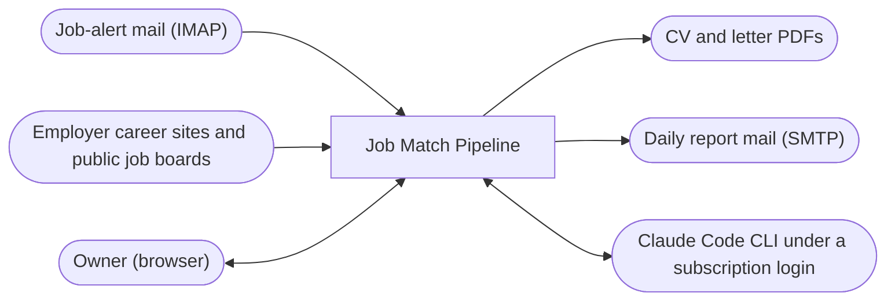
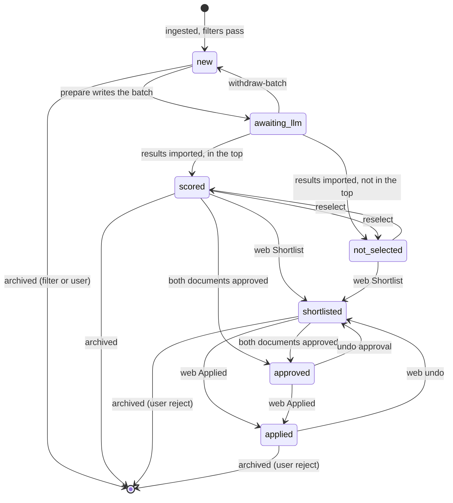

# Architecture

Version: 0.94.0
Date: 2026-11-14
Status: verified: service names and profiles from `compose.yaml`, module groups from the files in `app/`, statuses from `app/db.py` `STATUSES`, transitions from `app/batch.py`, `app/results.py`, `app/approval.py`, `app/web.py`, `app/rejection.py`, resilience and web-security statements from the module docstrings of `app/pipeline.py`, `app/watchdog.py`, `app/backup.py`, `app/web.py`, `app/weblogin.py` (read 14 Nov 2026). Unknown: memory limits in `compose.yaml` are first guesses by the code's own comments; behaviour on hardware other than the author's NAS.

The specification of record is `goal.md` (private repository). This page is the map for a reader who has not seen it.

## Context

Nothing is sent to an employer automatically. Documents are drafts until the owner approves them.

## Containers

One image, three services (`compose.yaml`, project name `recruitment`).

| Service | Profile | Command | Mounts | Notes |
|---|---|---|---|---|
| `recruitment` | always on | `python -m app schedule` | data, exchange, output, backups, logs, config and secrets read-only | Scheduler and place to run any CLI command with `docker compose exec`. Idles when `schedule.enabled` is false. Read-only root file system, all capabilities dropped, `no-new-privileges`, healthcheck reads a heartbeat file. |
| `web` | `web` | `python -m app web --supervise --port 8000` | data, output, backups (read-only), logs, config | FastAPI app. Port published only on the addresses named in `compose.env`. Needs a login and a Host allow-list to listen beyond localhost. |
| `llm` | `llm` | `python -m app llm-worker` | exchange, its own home folder, `llm.env` | Headless Claude Code worker. No database, no mail password, no config file. Own network, so it cannot reach `web`. |

Docker keeps at most 3 x 10 MB of each service's log output.

## Module map

All paths are under `app/`.

| Area | Modules | Role |
|---|---|---|
| Mailbox | `mailbox.py`, `alerts.py` | IMAP reading of alert folders; run alerts (raised, cleared, mailed) |
| Parsers | `parsers/jobsch.py`, `julius.py`, `linkedin.py`, `ubs.py` | One parser per alert-mail layout |
| Adapters | `adapters/` (`csb`, `greenhouse`, `julius`, `lgt`, `six`, `sygnum`, `workday`, `zurich`) | List jobs directly from employer career sites |
| Resolver | `resolver/`, `descriptions.py`, `descriptions_fetch.py`, `ubs_page.py` | Find the full description of a job that came without one; robots.txt, delays, daily caps |
| Dedup and merge | `dedup.py`, `merge.py` | One job from several sources; `merge-duplicates` after the fact |
| Filters | `filters/` (`language`, `poland`, `rules`, `runner`) | Rules only, no LLM; reason codes |
| Location and travel | `location.py`, `travel.py` | Place resolution, travel time with caching, 60 minute on-site and 120 minute hybrid limits |
| Batch, results, headless | `batch.py`, `results.py`, `schemas.py`, `prompt.py`, `headless.py`, `postpone.py`, `revisions.py` | Write the batch file, validate and import results, run the LLM worker, carry over unscored jobs, document revisions |
| Documents | `documents.py`, `traceability.py` (+ `traceability_vocab.yaml`), `pdf.py` (+ `fonts/`), `approval.py`, `rejection.py` | Store documents, fact check, render PDFs, approve and undo, reject |
| Report | `report.py`, `runreport.py`, `analytics.py`, `calibration.py` | Daily mail, per-run report, analytics numbers, scoring calibration sheets |
| Web | `web.py`, `weblogin.py`, `websuper.py`, `templates/`, `static/` | Server-rendered pages, login, supervisor |
| Scheduler and pipeline | `pipeline.py`, `scheduler.py`, `watchdog.py` | `prepare` and `finish`, run lock, daily loop, missed-schedule watchdog |
| Backup | `backup.py` | Verified backups, rotation, restore with a safety copy |
| Core | `db.py`, `models.py`, `config.py`, `cli.py`, `archive_recheck.py` | Schema and migrations, configuration checks, 39 CLI commands |

## Batch exchange: why files, not an API

`prepare` writes `exchange/batches/batch_<run_id>.json` (to a temporary name, then renamed). It holds the candidate jobs with their filter outcomes, the scoring prompt and its version, the output schemas, the SHA-256 of the profile files and a `tailoring` block that says who gets documents. A results file with the same run id comes back; `finish` validates its schema, checks that every job id belongs to the batch, runs the traceability check, renders the PDFs, stores everything and sends the report. Importing the same file twice changes nothing.

Why files: the language-model work runs under a subscription login, not a pay-per-token key, so there is no endpoint to call from the application. A file contract keeps the two sides independent: the app never needs model credentials, the model never needs the database, and the exchange folder is the only thing the `llm` service mounts. Both sides validate against the same JSON Schemas (`app/schemas.py`). When a usage limit cuts a run short, scores arrive in chunk files of at most 10 jobs, what is done is imported and the rest is carried over (`app/postpone.py`).

## Job status

Derived from `app/db.py` (`STATUSES`) and the code that changes it.

- A job that fails a hard filter is moved to `job_archive` with a stage (`filter`, `user` or `not_selected`) and a reason code (`archive_job` in `app/db.py`); `restore-job` and `recheck-*` commands can bring it back.
- Rejecting is allowed from `new`, `awaiting_llm`, `scored`, `not_selected`, `shortlisted`, `approved`, `applied` and `location_failed` (`REJECT_FROM`, `app/rejection.py`).
- `interview`, `offer`, `rejected`, `withdrawn` and `location_failed` are declared in `STATUSES` (and read by `app/analytics.py`), but no code path in `app/` sets them in this version. A restored archived job keeps `applied`, `interview` or `offer` and otherwise goes back to `new` (`RESTORED_STATUSES`, `app/db.py`).
- Undo is one step, only for `shortlisted` and `applied`, and only when the last history row is the change being undone (`undo_target`, `app/web.py`). Every change is a row in `status_history`.

## Resilience

| Concern | Mechanism | Where |
|---|---|---|
| Two runs at once | A run lock file taken by `prepare` and `finish`; a lock whose process is gone, or that cannot be read, is replaced; the web write routes that would collide are refused while it is held | `run_lock`, `app/pipeline.py` |
| Container stop or redeploy | SIGTERM raises `Interrupted` (a `BaseException`, so the steps' `except Exception` cannot swallow it); the run row is marked failed and the lock released; a second signal during clean-up is ignored | `app/pipeline.py` |
| Run that was cut off | The watchdog marks a `running` run failed, replaces a left-over lock and raises `run_interrupted`; it also raises `missed_schedule` when no `prepare` succeeded for too long. It never raises and always exits 0 | `app/watchdog.py` |
| Scheduler health | The loop touches a heartbeat file; the container healthcheck only reads it; a failed touch is logged, not fatal | `app/scheduler.py` |
| Backups | SQLite online backup API (safe with WAL), written under a temporary name, checked (integrity, schema version, row count of every table), then renamed; a bad copy is deleted; rotation touches only its own name pattern; restore first makes a safety copy that rotation never removes | `app/backup.py` |
| Partial results | A results file is rejected whole or per job with a stored reason; nothing is dropped silently; import is idempotent | `app/results.py` |
| Undo | One-step undo of approve, shortlist and applied, with refusal messages that say why | `app/approval.py`, `app/web.py` |
| LLM worker crash | The worker resumes parked runs by stage; a retry counter stops a crash loop; a full disk does not stop it | `app/headless.py` |

## Fetching ethics

- robots.txt is read first and respected, including crawl-delay; an honest User-Agent; a delay between requests to a host and a daily cap per host.
- Only the hosts of configured sources. No login, nothing done to avoid bot protection. The whole run stops at the first HTTP 403, 429 or 5xx.
- Tiers (`app/resolver/__init__.py`): a source with a written `permission_note` is tier 1; a public career site without one is tier 2 and is used only while `resolver.accept_t2_risk` is true. A third tier for LinkedIn was designed and then dropped: its robots.txt disallows everything.
- A job nobody can describe stays `description_missing` and is reported, not guessed.

## Web security

From the docstrings of `app/web.py` and `app/weblogin.py`.

- GET never writes: the database is opened `mode=ro` with `query_only`. Writes are POST only, each on its own connection, answered with a 303 redirect.
- A CSRF token in every form: HMAC-SHA256 over the action and job id with a secret made at start-up, compared with `hmac.compare_digest`; a wrong token gives 403.
- The Host header must be on the allow-list; a POST with an Origin or Referer that is not the app's own origin gets 403 (Origin `null` too). No CORS headers.
- Listening beyond localhost is allowed only with `RECRUITMENT_CONTAINER=1`, a Host allow-list, a user name and a password hash.
- Login: scrypt hash (N = 2^17, r = 8, p = 1), signed stateless cookie (`HttpOnly`, `SameSite=Lax`), throttled attempts, a bounded queue so a flood of attempts cannot start unlimited hashing.
- Content-Security-Policy allows forms to the app only; scripts only on the two chart pages; the form body must be `application/x-www-form-urlencoded` and small.
- The web app never migrates the database.

## Testing strategy

- 3,404 tests collected at v0.93.0 (`pytest --collect-only`), one test file per area (`tests/`).
- Everything external is injected (mail client factory, travel-time providers, SMTP factory, page fetcher), so unit tests run offline against saved fixtures in `tests/fixtures/`.
- `tests/fixtures/fake_claude.py` is a fake `claude` executable: it reads a `mode.json`, writes the files a role would write and records every call, so the whole headless chain (scorer, letters, review, resume, parking) is tested without a model.
- Tests that touch real sites are separate files (`*_network.py`) and skip unless `RECRUITMENT_NETWORK_TESTS=1`.
- Isolation tests (`test_isolation.py`, `test_env_isolation.py`, `real_path_guard.py`) check that tests never touch the real database or paths.
- A bug fix comes with a test that fails first.
