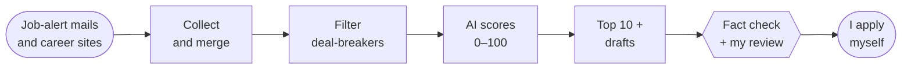
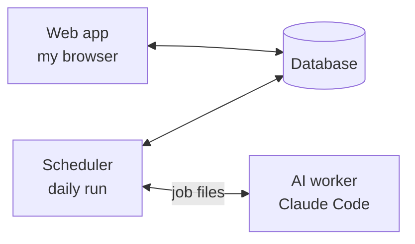
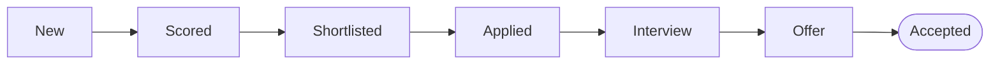

<!--
Version: 0.105.0
Date: 2026-11-17
Status: verified: services from compose.yaml, stages from app/db.py and app/statusflow.py, guardrails from app/traceability.py, app/backup.py and app/web.py (read 14 to 17 Nov 2026).
-->

# How it works

## The big picture

Every morning the app collects new alerts, merges duplicates, sets aside jobs that break a hard rule, and asks the AI to score the rest. The best ten get a tailored CV and cover letter. Nothing leaves the app until I have read it.

## Four ideas behind it

### 1. Rules first, AI second
Language, commute and work mode are plain rules with a readable reason ("on-site, 85 minutes away"). Only the jobs that pass go to the AI, so it spends its effort where judgement is needed.

### 2. The AI can't make things up
All CV facts live in one file. Every employer, date, number and skill in a generated document is checked against it, and anything that doesn't match blocks the document. A second, stronger AI model reviews the wording of every draft before I see it.

### 3. It runs at home, for free
One Docker image with three services on a home server: a scheduler, the web app and the AI worker. The AI worker uses a normal Claude subscription, no pay-per-use API, and it never sees the database or any passwords.

The scheduler and the AI worker swap plain job files instead of calling each other, so each side can be tested and replaced on its own.

### 4. Safe by default
- **Backups** are checked after writing, and a restore keeps a safety copy first.
- **Undo** exists for every status change and approval.
- **A run that is cut off** is noticed and reported; a half-finished run never corrupts data.
- **The web app** needs a login, refuses foreign requests and never changes data on a simple page view.

## Following one job

Each step is one click in the web app, each can be undone, and every change is kept in a history. Interview rounds and notes hang off the job, and the analytics page shows how long each stage takes.

## How it is tested

- **3,800+ automated tests**, one file per area.
- Everything outside the app (mail, maps, websites, the AI) is replaced by a stand-in during tests, so the whole suite runs offline in about two and a half minutes.
- A fake AI program plays every AI role, so the full daily run is tested without a real model.
- Every bug fix starts with a test that fails, then passes.

## Built with

Python · FastAPI · Jinja2 · SQLite · Docker · Claude Code · Chart.js · pytest · Next.js (landing page)

Next: [Working with AI agents →](AI_WORKFLOW.md)
