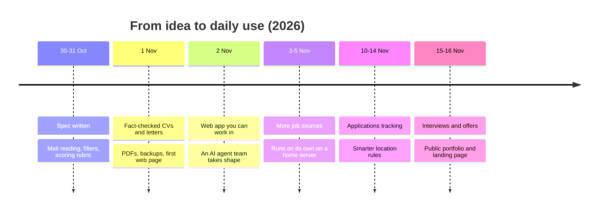

<!--
Version: 0.105.0
Date: 2026-11-17
Status: verified: every date and version from CHANGELOG.md and the git tags (read 17 Nov 2026); test and release counts as measured in the README.
-->

# The story

**16 days to daily use, 190+ releases, 3,800+ tests.** How a pile of job alerts turned into a working product.

## Week 1: from a blank page to a working pipeline

### 30–31 Oct: requirements before code
The project started the way my work projects start: with a written specification. What problem, which rules, what counts as "done", and what is still unknown. Only when that was agreed (v0.5) did code begin.

By the end of day two the backbone was in place:
- reading job-alert mails from several job boards,
- merging duplicates, so one job is one record,
- plain rules for the deal-breakers (language, commute, work mode), each with a reason you can read,
- a scoring rubric from 0 to 100, approved before the AI ever used it,
- the first employer career sites read directly.

### 1 Nov: documents I can trust
The goal was never "AI writes my applications". It was "AI drafts, I decide". So the day went into guardrails:
- a **fact checker** that blocks any CV or letter mentioning an employer, number or skill that is not in my real CV,
- clean PDF rendering,
- verified **backups** with restore,
- the first, read-only web page: *Today's Top 10*.

A rule set that day still holds: *never overstate a language level.* The fact checker enforces it in every document.

### 2 Nov: a tool I can actually use
I wanted to read and approve the drafts in the browser, not in files. The web app gained approve and undo, run health, and analytics charts.

The same day I looked at how the AI work was split and reorganised it into a **team of specialised agents**: cheap, fast models for reading and running tests, a stronger one for writing code, the strongest only for planning and review. More on that in [Working with AI agents](AI_WORKFLOW.md).

### 3–5 Nov: more sources, less manual work
- Readers for the big public job platforms and more employer sites.
- Usage limits handled gracefully: work is saved in small chunks and the rest continues next run.
- Since **v0.78** the AI part runs **on its own on a home server**, under a normal subscription and without paid API keys.

## Week 2: from a pipeline to a product

### 10–14 Nov: following an application through
- An **Applied** page, then reject with a comment, and a self-service page for documents the fact checker blocked.
- A fourth job-board mail source.
- Smarter **location rules**: hybrid jobs may be further away than on-site ones, and old rejections are rechecked automatically.

### 15 Nov: interviews and offers
- Application stages from *Applied* to *Interview*, *Offer* and *Accepted*, with bulk changes for several jobs at once.
- **Interview rounds and notes**, with statistics on how long each step takes.
- A **demo mode** with fictional jobs, so the app can be shown without personal data.

### 16 Nov: ready to show
- A **landing page** with my CV, and ATS-friendly PDF CVs.
- This **public portfolio copy**: same code, a fictional persona, no personal data.

## What it shows

| Habit | In this project |
|---|---|
| Requirements first | One written spec; every decision recorded with its date |
| Small, safe steps | 190+ releases, each with a version and a changelog entry |
| Evidence over opinion | 3,800+ automated tests; a bug fix starts with a test that fails |
| People decide | The app can't send anything; every application is mine |

Next: [How it works →](HOW_IT_WORKS.md)
